# MFM Financial Management System — Frontend

A Windows desktop application for church financial and administrative management, built with **C#, WPF, and XAML**.

MFMFMS provides a centralized interface for managing church financial records, reviewing contributions and expenditures, organizing church meetings, and analyzing financial performance through dashboards and reports.

The frontend is developed as a standalone desktop client for the MFM Financial Management System backend API.

**Project status:** In development

---

## Screenshots

The following screenshots showcase the current user interface.

### Dashboard

Provides an overview of church finances, summary cards, financial charts, recent records, and quick actions.

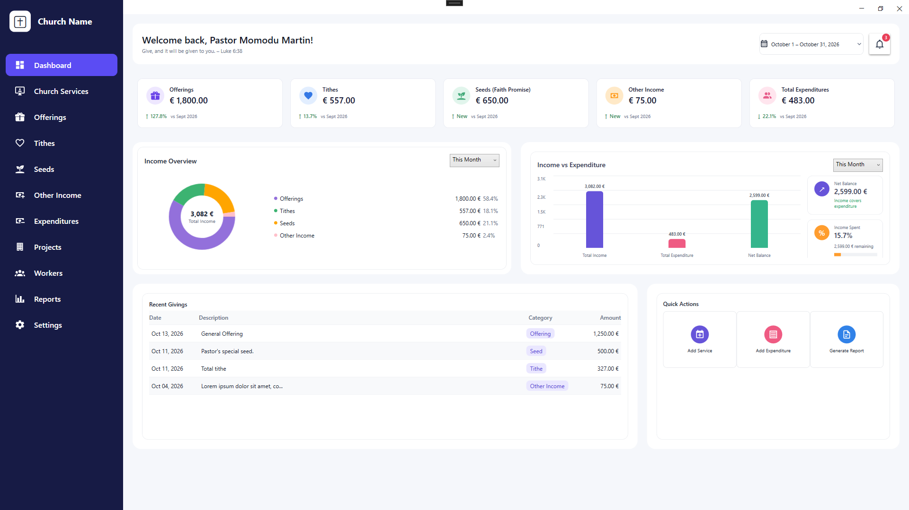

### Church Meetings

Browse and review church meeting records, attendance information, and meeting details.

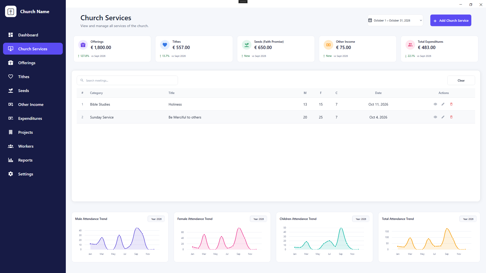

### Meeting Details

View the information associated with an individual church meeting.

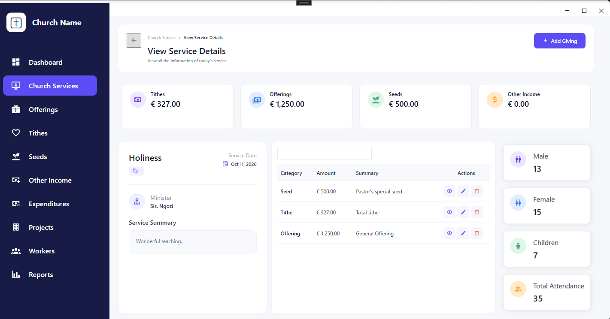

### Create a Meeting

Enter meeting information, including the date, category, message title, minister, attendance, and summary.

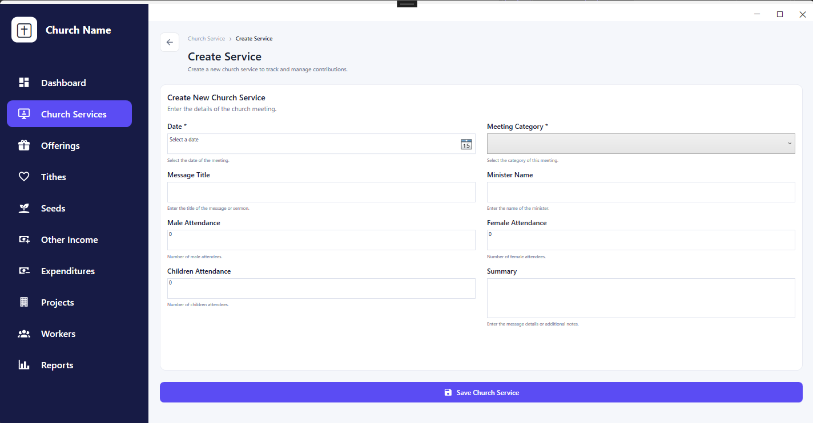

### Offerings

Review offering records and visualize giving trends.

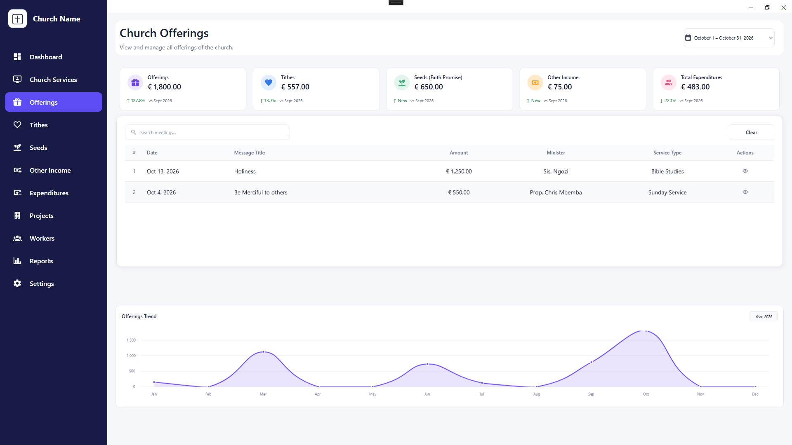

### Expenditures

Review church expenditure records and financial trends.

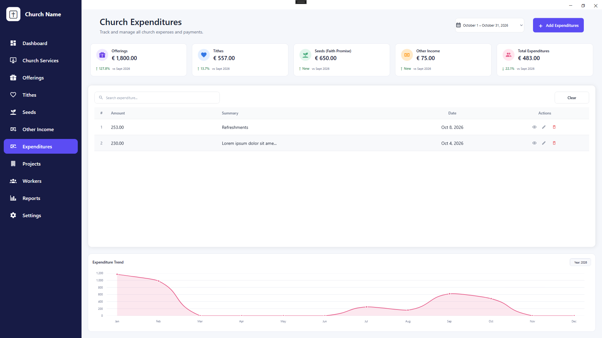

### Expenditure Details

Inspect individual expenditure transactions, including their amounts, dates, and descriptions.

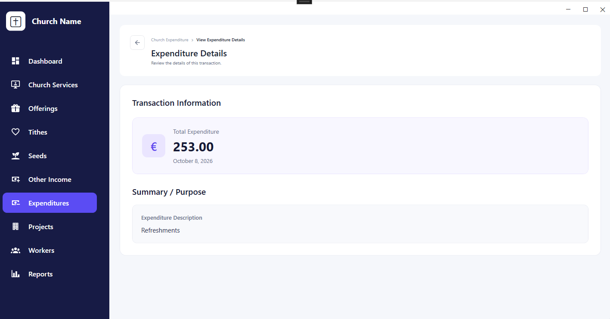

### Reports Overview

Analyze financial summaries, income, expenditures, and net income.

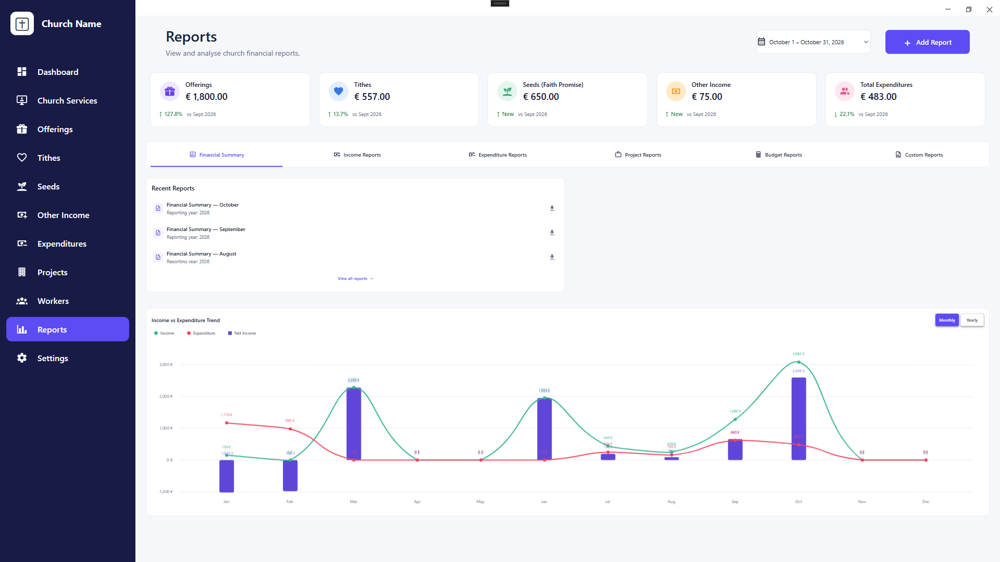

### Income Report

Review income categories, including offerings, tithes, seeds, and other income.

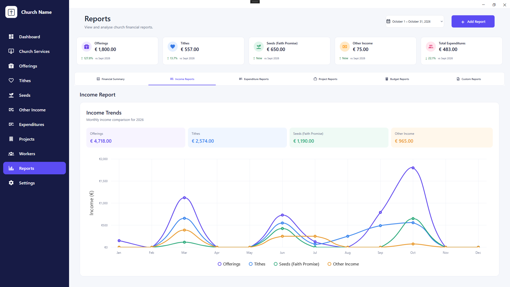

### Monthly Report

Review the monthly financial summaries, including income, expenditures, and net income.

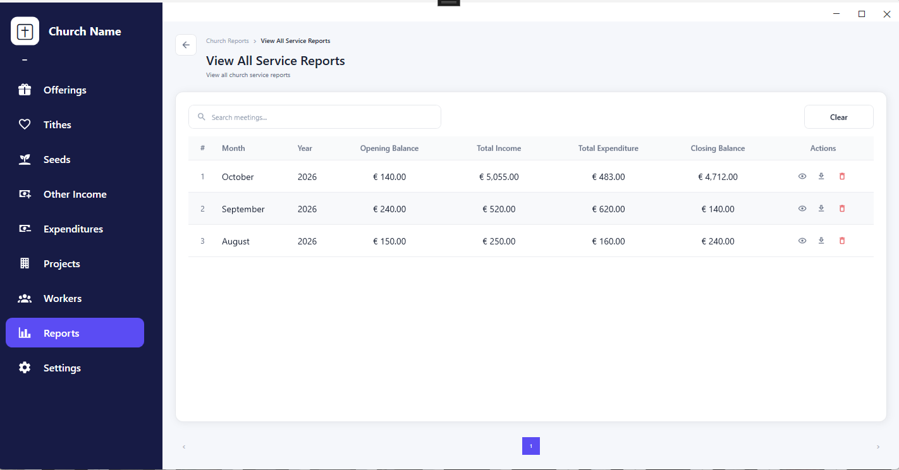

### Report PDF View

Review the PDF view of the financial reports, including income, expenditures, net income and meeting details.

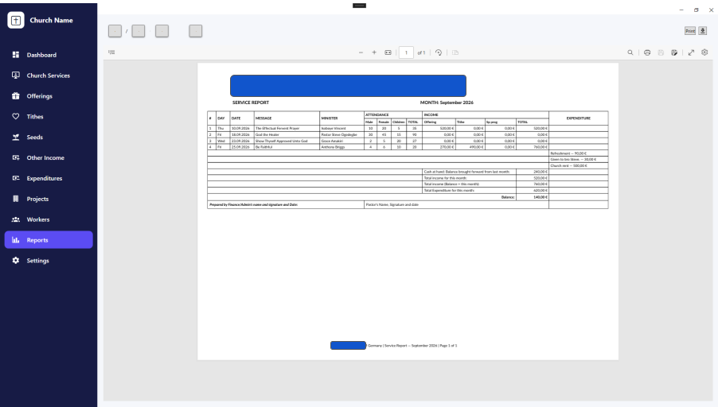


---

## Features

### Dashboard and financial overview

- Financial summary cards and key indicators.
- Income and expenditure visualizations.
- Recent financial records.
- Quick-action interface.
- Date-range selection for financial analysis.

### Church meetings

- Browse and search meeting records.
- View meeting details.
- Enter meeting dates, categories, message titles, and minister information.
- Record attendance figures for men, women, and children.
- Display meeting attendance trends.

### Financial management

- Offerings and giving records.
- Tithes and seed contributions.
- Other income records.
- Expenditure records and transaction details.
- Project-related financial management.

### Reports and analytics

- Financial summary reports.
- Income and expenditure analysis.
- Net income comparisons.
- Monthly and yearly trends.
- Income category comparisons.

### Application interface

- WPF desktop interface built with XAML.
- Sidebar-based navigation.
- Reusable UI controls and components.
- Shared color palette, typography, shadows, and styles.
- Consistent buttons, inputs, cards, tables, and icons.
- Chart visualizations using LiveCharts.

**Implementation note:** These features describe the intended application scope and the screens represented by the current UI. Data persistence, API connectivity, authentication, and individual operations depend on their actual implementation and integration status.

---

## Technology Stack

| Technology | Purpose |
|---|---|
| C# | Application logic |
| .NET 9 | Application framework |
| WPF | Windows desktop interface |
| XAML | UI layout and styling |
| MaterialDesignThemes.Wpf 5.3.2 | Material Design resources and controls |
| MaterialDesignColors 5.3.2 | Material Design color resources |
| LiveChartsCore.SkiaSharpView.WPF 2.0.5 | Charts and visualizations |
| Microsoft.Web.WebView2 1.0.4258.31 | Embedded web content when required |
| ASP.NET Core REST API | Intended backend integration |

---

## Architecture

The solution separates the desktop UI from the backend and shared application components.

```text
MFM_Financial_Management_System.Frontend
│
├── MFMFMSF.UI
│   ├── Assets
│   ├── Commands
│   ├── Controls
│   ├── Converters
│   ├── Features
│   │   ├── Dashboard
│   │   ├── Expenditures
│   │   ├── Givings
│   │   ├── Meetings
│   │   ├── Offering
│   │   ├── OtherIncome
│   │   ├── Projects
│   │   ├── Reports
│   │   ├── Seeds
│   │   ├── Settings
│   │   ├── Tithes
│   │   └── Workers
│   ├── Navigation
│   ├── Resources
│   ├── Themes
│   ├── Utilities
│   ├── ViewModels
│   ├── App.xaml
│   ├── MainWindow.xaml
│   └── MFMFMSF.UI.csproj
│
├── MFMFMSF.Core
├── MFMFMSF.Infrastructure
├── MFMFMSF.Shared
├── MFMFMSF.Core.Tests
├── MFMFMSF.Infrastructure.Tests
└── README.md
```

The diagram represents the main projects and folders visible in the current solution. Individual files and subfolders may evolve during development.

### Project responsibilities

- **MFMFMSF.UI:** WPF interface, navigation, feature screens, reusable controls, and presentation resources.
- **MFMFMSF.Core:** Core application and domain-related functionality.
- **MFMFMSF.Infrastructure:** Infrastructure and external-service implementation.
- **MFMFMSF.Shared:** Shared types and functionality used across projects.
- **Test projects:** Automated tests for core and infrastructure functionality.

### Backend integration

The desktop application is intended to communicate with the ASP.NET Core backend through HTTP/HTTPS APIs.

```text
┌──────────────────────────────┐
│        MFMFMSF.UI            │
│        C# / WPF / XAML       │
│                              │
│  Views · Controls · Features │
└──────────────┬───────────────┘
               │
               │ HTTP / HTTPS
               ▼
┌──────────────────────────────┐
│       ASP.NET Core API       │
│                              │
│ Endpoints · Business Rules   │
└──────────────┬───────────────┘
               │
               ▼
┌──────────────────────────────┐
│          Database            │
└──────────────────────────────┘
```

The backend is responsible for server-side business rules, data access, and database operations. The frontend should not connect directly to the production database.

The exact API endpoints, authentication flow, and configuration mechanism will be documented as those integrations are finalized.

---

## Shared Design System

The application uses a centralized design system through `App.xaml` and merged resource dictionaries.

The current configuration includes:

| Resource dictionary | Responsibility |
|---|---|
| `Colors.xaml` | Shared application colors |
| `Shadows.xaml` | Shadow and elevation styles |
| `Typography.xaml` | Text styles and typography |
| `Inputs.xaml` | Input control styles |
| `Buttons.xaml` | Button styles |
| `Cards.xaml` | Card styles |
| `Tables.xaml` | Table and data-grid styles |
| `Icons.xaml` | Icon-related resources |
| `GeneralStyles.xaml` | General application styles |

Material Design defaults are also merged into the application resources.

Centralizing these resources helps maintain a consistent visual identity and makes future UI changes easier to manage.

---

## Getting Started

### Prerequisites

- Windows.
- Visual Studio 2022 or a compatible Visual Studio version with .NET 9 support.
- The **.NET desktop development** workload.
- The .NET 9 SDK.
- Git, if cloning the repository.
- The backend API, when running features that require server data.

### Installation

1. Clone the frontend repository.

   ```bash
   git clone <YOUR_FRONTEND_REPOSITORY_URL>
   ```

2. Open the solution in Visual Studio.

   ```text
   MFM_Financial_Management_System.Frontend.sln
   ```

   If the solution filename differs in your checkout, open the actual `.sln` file in the repository root.

3. Restore NuGet packages.

   ```bash
   dotnet restore
   ```

4. Build the solution.

   ```bash
   dotnet build
   ```

5. In Visual Studio, set `MFMFMSF.UI` as the startup project.

6. Run the application using **F5** or **Ctrl+F5**.

Alternatively, launch the UI project from the command line:

```bash
dotnet run --project MFMFMSF.UI/MFMFMSF.UI.csproj
```

Adjust the project path if the `.csproj` file is located in a different directory.

---

## Configuration

The UI project targets `net9.0-windows` and enables WPF.

Backend settings should be configured for the relevant environment using the configuration mechanism implemented in the application.

- **Development:** Use the local ASP.NET Core API address.
- **Testing:** Use the API instance configured for testing.
- **Production:** Use the deployed API's HTTPS address.

Do not commit passwords, API secrets, access tokens, or other sensitive configuration values to source control.

If API configuration or authentication has not yet been implemented, these steps remain part of the integration work.

---

## Development Guidelines

To keep the application maintainable as the project grows:

1. Organize screens and related components by feature.
2. Reuse the centralized design system instead of duplicating styles.
3. Keep presentation logic separate from business logic.
4. Use the shared and core projects for functionality that should not depend on WPF.
5. Communicate with the backend through its API rather than accessing the production database directly.
6. Add tests for important application and infrastructure behavior.
7. Keep UI state, loading indicators, validation, and error handling consistent across screens.

---

## Roadmap

The following items represent ongoing development and integration priorities. Their completion status should be updated as work progresses.

- [ ] Finalize shared styles, controls, and navigation.
- [ ] Review and standardize the ViewModel and command patterns.
- [ ] Complete API client configuration and connectivity.
- [ ] Implement and verify authentication and authorization.
- [ ] Connect dashboard summaries and charts to real API data.
- [ ] Complete end-to-end financial record workflows.
- [ ] Complete reporting and export functionality where required.
- [ ] Add input validation, error handling, and loading states.
- [ ] Expand automated test coverage.
- [ ] Prepare application packaging and deployment instructions.

---

## Related Project

**MFM Financial Management System — Backend**

The backend is maintained separately and provides the API for server-side operations and data access.

- Backend repository: Add the actual backend repository URL when ready.

Backend setup instructions, API documentation, database configuration, and backend-specific requirements belong in the backend repository.

---

## License

Private / Organizational Use
